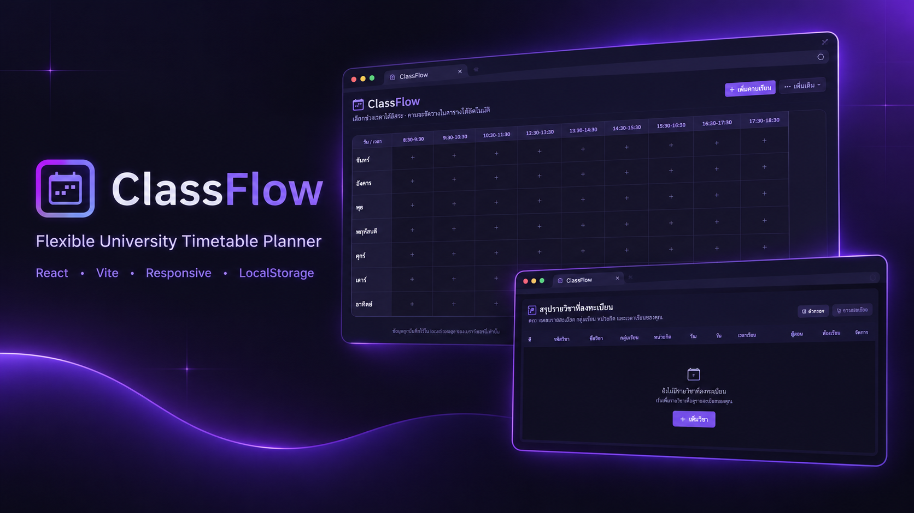

# 📅 ClassFlow App — ตารางเรียนของฉัน

เว็บแอปพลิเคชันสำหรับจัดตารางเรียนรายสัปดาห์ พัฒนาด้วย **React + Vite** มาพร้อมธีม **Dark / Purple** ที่เรียบง่าย ทันสมัย และออกแบบให้ใช้งานได้ทั้งบนคอมพิวเตอร์ แท็บเล็ต และโทรศัพท์มือถือ

ClassFlow ช่วยให้คุณจัดตารางเรียนตามช่วงเวลาจริง จัดการรายละเอียดรายวิชา นำข้อมูลจากคาบเรียนเดิมมาใช้ซ้ำ และส่งออกตารางเรียนได้หลายรูปแบบ ไม่ว่าจะเป็น PDF, PNG, JSON หรือ Excel

ข้อมูลตารางเรียนจะถูกจัดเก็บไว้ในเบราว์เซอร์ด้วย `localStorage` จึงไม่จำเป็นต้องสมัครบัญชีผู้ใช้หรือติดตั้ง Backend

<p align="center">
  
  
  
  
  
</p>

---

## 🖥️ ตัวอย่างหน้าเว็บ

<p align="center">
  
</p>

---

## ✨ ฟีเจอร์หลัก

### 🗓️ จัดตารางเรียนได้อย่างยืดหยุ่น

- **กำหนดช่วงเวลาเรียนได้เอง** — ระบุเวลาเริ่มต้นและสิ้นสุดของแต่ละคาบได้ตามต้องการ ไม่จำกัดเฉพาะช่วงเวลามาตรฐาน
- **แสดงตารางตามเวลาเรียนจริง** — จัดวางคาบเรียนตามช่วงเวลาที่กำหนด พร้อมรองรับช่วงเวลาที่มีความยาวแตกต่างกัน
- **เพิ่ม แก้ไข และลบคาบเรียน** — จัดการข้อมูลตารางเรียนได้สะดวก
- **เลือกสีประจำวิชา** — ใช้สีที่เตรียมไว้หรือเลือกสีด้วย Color Picker เพื่อแยกประเภทและจดจำรายวิชาได้ง่ายขึ้น

### ♻️ ใช้ข้อมูลวิชาเดิมซ้ำได้

- เลือกคาบเรียนที่เคยเพิ่มไว้ เพื่อนำรายละเอียดรายวิชามาใช้กับคาบใหม่
- เติมรายละเอียดที่เกี่ยวข้องให้อัตโนมัติ ช่วยลดการกรอกข้อมูลซ้ำ
- กำหนดวันและเวลาเรียนของคาบใหม่ได้เอง

### 📋 ตารางสรุปรายวิชา

- แสดงรายละเอียดรายวิชาในรูปแบบตารางสรุป
- รวมคาบเรียนที่เป็นรายวิชาเดียวกันไว้ด้วยกันตามข้อมูลที่ใช้ระบุวิชา
- แสดงวัน เวลา ผู้สอน และห้องเรียนของแต่ละคาบ
- แสดงข้อมูลหน่วยกิตในระดับรายวิชา ช่วยให้ดูภาพรวมได้ง่ายขึ้น

### 📱 Responsive Design

- ปรับหน้าตาให้เหมาะสมกับหน้าจอคอมพิวเตอร์ แท็บเล็ต และโทรศัพท์มือถือ
- รองรับการเลื่อนดูตารางในกรณีที่มีคอลัมน์มากกว่าพื้นที่หน้าจอ
- ออกแบบส่วนควบคุมให้ใช้งานสะดวกบนหน้าจอขนาดเล็ก

### 💾 บันทึกข้อมูลอัตโนมัติ

- บันทึกข้อมูลตารางเรียนลงใน `localStorage`
- ไม่ต้องสมัครสมาชิกหรือเข้าสู่ระบบ
- สามารถกลับมาเปิดเว็บในเบราว์เซอร์เดิมและใช้งานข้อมูลที่บันทึกไว้ได้
- มีตัวเลือกสำหรับล้างข้อมูลตารางเรียน

### 📤 ส่งออกตารางเรียนและสำรองข้อมูล

ClassFlow รองรับการส่งออกข้อมูลหลายรูปแบบ เพื่อให้สามารถนำตารางเรียนไปเปิดดู แชร์ หรือจัดการต่อในแอปอื่นได้

| รูปแบบ              | รายละเอียด                                                                                   |
| ------------------- | -------------------------------------------------------------------------------------------- |
| **PDF (`.pdf`)**    | ส่งออกตารางเรียนเป็น PDF โดยกำหนดขนาดหน้าตามภาพตารางจริง ไม่บังคับใช้กระดาษ A4               |
| **PNG (`.png`)**    | บันทึกตารางเรียนเป็นรูปภาพ โดยพยายามจับภาพให้ครบทั้งความกว้างและความสูงของตาราง              |
| **JSON (`.json`)**  | สำรองข้อมูลคาบเรียน เพื่อนำไฟล์ไปเก็บไว้ใช้ในภายหลัง                                         |
| **Excel (`.xlsx`)** | ส่งออกตารางเรียนพร้อมรายละเอียดรายวิชา สำหรับเปิดใน Microsoft Excel หรือแอปสเปรดชีตที่รองรับ |

**รายละเอียดการส่งออกที่สำคัญ**

- PDF และ PNG ใช้ `html2canvas` จับภาพตาราง โดยคำนึงถึงขนาดของตารางจริง ไม่ใช่เฉพาะพื้นที่ที่มองเห็นบนหน้าจอ
- ปรับความละเอียดของภาพตามขนาดตาราง เพื่อลดความเสี่ยงจากข้อจำกัดของ Canvas บนอุปกรณ์บางประเภท
- PDF ใช้ขนาดหน้าตามภาพตาราง จึงไม่จำเป็นต้องบีบตารางให้พอดีกระดาษ A4
- Excel ประกอบด้วยชีตตารางเรียนและชีตรายละเอียดวิชา
- การดาวน์โหลดใช้วิธีสร้างไฟล์ Blob และลิงก์ดาวน์โหลดผ่านเบราว์เซอร์

> **หมายเหตุ:** พฤติกรรมการดาวน์โหลดอาจแตกต่างกันตามเบราว์เซอร์ หากเปิดเว็บผ่าน In-App Browser เช่น LINE, Messenger หรือ Instagram แล้วดาวน์โหลดไม่ได้ แนะนำให้เลือกเปิดเว็บไซต์ในเบราว์เซอร์ภายนอก เช่น Chrome หรือ Safari

---

## 🛠️ Tech Stack & Tools

| เทคโนโลยี                                                                            | หน้าที่                                        |
| ------------------------------------------------------------------------------------ | ---------------------------------------------- |
| [React](https://react.dev/)                                                          | สร้าง UI ด้วย Component และจัดการ State        |
| [Vite](https://vite.dev/)                                                            | Development Server และ Build โปรเจกต์          |
| [Bootstrap 5](https://getbootstrap.com/)                                             | Layout และองค์ประกอบ UI                        |
| [Bootstrap Icons](https://icons.getbootstrap.com/)                                   | ไอคอนภายในแอป                                  |
| [SweetAlert2](https://sweetalert2.github.io/)                                        | กล่องแจ้งเตือนและหน้าต่างยืนยันการทำงาน        |
| [html2canvas](https://html2canvas.hertzen.com/)                                      | จับภาพองค์ประกอบ HTML สำหรับการส่งออก          |
| [jsPDF](https://github.com/parallax/jsPDF)                                           | สร้างไฟล์ PDF                                  |
| [ExcelJS](https://github.com/exceljs/exceljs)                                        | สร้างไฟล์ Excel (`.xlsx`)                      |
| Custom CSS                                                                           | ธีม Dark / Purple, Animation และ Responsive UI |
| [localStorage](https://developer.mozilla.org/en-US/docs/Web/API/Window/localStorage) | บันทึกข้อมูลในเบราว์เซอร์                      |
| [Vercel](https://vercel.com/)                                                        | Deploy เว็บแอปพลิเคชัน                         |

---

## 📁 Project Structure

```text
schedule-app/
├── index.html
├── package.json
├── vite.config.js
├── public/
│   └── ...                     # Static assets เช่น favicon
└── src/
    ├── main.jsx                # จุดเริ่มต้นและ Mount React
    ├── App.jsx                 # State และ Logic หลักของแอป
    ├── index.css               # สไตล์และธีมหลัก
    ├── components/
    │   ├── Toolbar.jsx         # เครื่องมือและเมนูส่งออก
    │   ├── ScheduleTable.jsx   # ตารางเรียนแบบ Timeline
    │   ├── ClassModal.jsx      # ฟอร์มเพิ่มและแก้ไขคาบเรียน
    │   ├── Summary_subject.jsx # ตารางสรุปรายวิชา
    │   └── Footer.jsx          # ส่วนท้ายของแอป
    ├── data/
    │   └── constants.js        # ค่าคงที่ เช่น รายชื่อวันและสีเริ่มต้น
    ├── image/
    │   └── example_web.png     # ภาพตัวอย่างหน้าเว็บสำหรับ README
    └── utils/
        ├── time.js             # ฟังก์ชันจัดการเวลา
        ├── storage.js          # อ่านและบันทึกข้อมูลใน localStorage
        ├── exporters.js        # ส่งออก PDF, PNG, JSON และ Excel
        └── modal.js            # ฟังก์ชันช่วยจัดการ Modal และการแจ้งเตือน
```

> โครงสร้างนี้อ้างอิงจากโครงสร้างโปรเจกต์ที่ระบุไว้ ควรตรวจสอบกับ Repository จริงอีกครั้งหากมีการเพิ่ม ลบ หรือเปลี่ยนชื่อไฟล์

---

## 🚀 Getting Started

### 1. สิ่งที่ต้องมี

- [Node.js](https://nodejs.org/) เวอร์ชันที่รองรับกับ Dependencies ของโปรเจกต์
- npm ซึ่งมาพร้อมกับ Node.js
- Git หากต้องการ Clone โปรเจกต์จาก Repository

### 2. ดาวน์โหลดโปรเจกต์

หากมีโปรเจกต์ในเครื่องอยู่แล้ว สามารถเปิด Terminal ในโฟลเดอร์นั้นได้เลย

หากต้องการ Clone จาก Git Repository:

```bash
git clone <repository-url>
cd <project-folder>
```

แทนที่ `<repository-url>` ด้วย URL ของ Repository จริง และ `<project-folder>` ด้วยชื่อโฟลเดอร์ของโปรเจกต์

### 3. ติดตั้ง Dependencies

```bash
npm install
```

### 4. รันในโหมด Development

```bash
npm run dev
```

เปิด URL ที่แสดงใน Terminal โดยปกติ Vite จะใช้:

```text
http://localhost:5173
```

### 5. ทดลองใช้งานบนมือถือ

หากคอมพิวเตอร์และมือถือเชื่อมต่อ Wi-Fi เครือข่ายเดียวกัน ให้รัน:

```bash
npm run dev -- --host
```

จากนั้นเปิด Network URL ที่แสดงใน Terminal บนมือถือ หากเข้าไม่ได้ ให้ตรวจสอบเครือข่ายและการตั้งค่า Firewall

---

## 📦 Build สำหรับ Production

สร้างไฟล์สำหรับนำไป Deploy:

```bash
npm run build
```

ไฟล์ที่ Build แล้วจะอยู่ในโฟลเดอร์ `dist/`

ทดสอบ Production Build ในเครื่อง:

```bash
npm run preview
```

สามารถ Deploy โปรเจกต์บน [Vercel](https://vercel.com/) หรือ [Netlify](https://www.netlify.com/) ได้ โดยตรวจสอบการตั้งค่า Build Command และ Output Directory ให้ตรงกับโปรเจกต์

สำหรับ Vite โดยทั่วไปจะใช้:

| รายการ           | ค่า             |
| ---------------- | --------------- |
| Build Command    | `npm run build` |
| Output Directory | `dist`          |

หากเชื่อม GitHub กับ Vercel สามารถตั้งค่าให้ Deploy ใหม่อัตโนมัติเมื่อ Push โค้ดไปยัง Branch ที่กำหนดได้

---

## 💡 ข้อควรรู้เกี่ยวกับข้อมูล

- ข้อมูลตารางเรียนถูกจัดเก็บใน `localStorage` ของเบราว์เซอร์
- ข้อมูลไม่ได้ซิงก์ข้ามอุปกรณ์หรือข้ามเบราว์เซอร์โดยอัตโนมัติ
- หากล้างข้อมูลเว็บไซต์หรือ Browser Data ข้อมูลที่บันทึกไว้อาจหายได้
- การเปิดเว็บบนอุปกรณ์ใหม่จะไม่ทำให้ข้อมูลจากอุปกรณ์เดิมปรากฏขึ้นเอง
- แนะนำให้ Export JSON เพื่อสำรองข้อมูลเป็นระยะ และเก็บไฟล์ไว้ในที่ปลอดภัย
- ฟังก์ชันส่งออกขึ้นอยู่กับความสามารถและข้อจำกัดของเบราว์เซอร์ที่ใช้

---

## 🔮 แนวทางพัฒนาต่อในอนาคต

ไอเดียสำหรับการต่อยอด ClassFlow ในอนาคต ได้แก่

- **📥 Import JSON** — นำข้อมูลจากไฟล์สำรองกลับเข้ามาในแอป
- **📚 แยกภาคการศึกษา** — จัดเก็บตารางเรียนหลายเทอม
- **☁️ Cloud Sync** — ซิงก์ข้อมูลข้ามอุปกรณ์ผ่าน Backend
- **🎨 Theme Customization** — ปรับแต่งสีและรูปแบบ UI เพิ่มเติม
- **🧪 Automated Testing** — เพิ่มการทดสอบอัตโนมัติสำหรับฟังก์ชันหลักและการส่งออกไฟล์

รายการเหล่านี้เป็นแนวทางต่อยอด ไม่ใช่ฟีเจอร์ที่ยืนยันว่ามีอยู่แล้วในเวอร์ชันปัจจุบัน

---

<p align="center">
  <strong>Made with 💜 for a more organized study life.</strong><br />
  <sub>ClassFlow App — ตารางเรียนของฉัน</sub>
</p>
